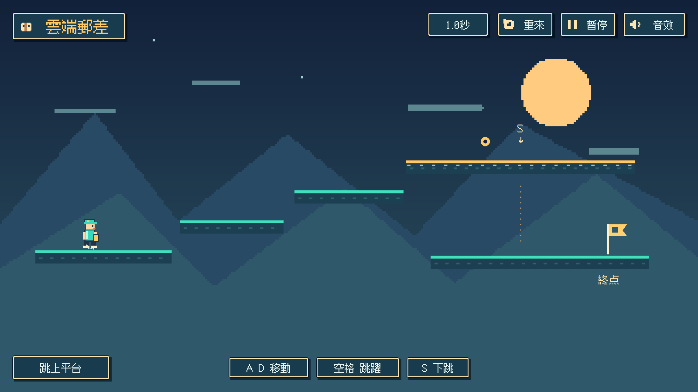
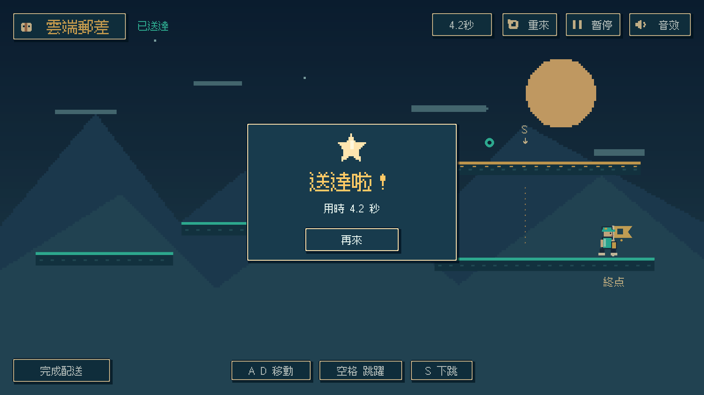

# 作業二 2D 角色操作

學號：F15440011  
姓名：萬紓語  
GitHub：https://github.com/longqingcheng01-design/1151VR-HW2-F15440011-WanShuYu  
YouTube：待補充

## 專案內容

雲端郵差 Sky Courier 是使用 Unity 2022.3.62f1 製作的 2D 角色操作關卡。角色載入原創 PNG 人物圖片，在平台上往前走、向上跳躍，再從上層單向平台向下跳到終點。場景、角色、碰撞器、動畫控制器與繁體中文像素介面都已保存為 Unity 原生資產。

## 操作方式

- D 或右方向鍵往前走；A 或左方向鍵回走。
- W、空白鍵或上方向鍵上跳。
- S 或下方向鍵從金色上層平台下穿；空中按下可加速下落。
- R 或「重來」按鈕重新開始；P 或 Esc 暫停與繼續；M 切換音效。
- 路線：起點 → 向右跳上兩級平台 → 金色上層的標記 → 按 S 下穿 → 在下層向右走到終點旗幟。

## 製作流程

1. 建立 2D 專案，匯入原創人物 PNG 圖集、背景和平台圖片，使用 SpriteRenderer 顯示。
2. 為角色加入 Rigidbody2D 與 CapsuleCollider2D，平台加入 BoxCollider2D。水平速度為 5，跳躍初速為 8.6，重力倍率為 2.6；使用物理速度更新移動，讓碰撞與落地由物理引擎處理。
3. PlayerController 使用真正的 `Vector2[] moveDirections` 陣列，依序保存 `Vector2.right`、`Vector2.up`、`Vector2.down`。水平速度取第 0 個向量乘移動量與速度；上跳取第 1 個向量乘跳躍初速；下穿取第 2 個向量乘下落初速。
4. 使用 `List<Vector3> pathHistory` 每 0.2 秒記錄位置。每次重新開始清空路徑與動作計數。
5. 金色上層平台使用 PlatformEffector2D；下跳時暫時忽略角色與該平台的碰撞，完全通過後恢復碰撞。下層平台仍正常碰撞，不會穿過終點地面。
6. 透過 Animator 和四組 AnimationClip 實現待機、跑步、上跳與下落；以 SpriteRenderer.flipX 做左右轉向。加入跳躍、落地、下跳、檢查點、成功和失敗音效，以及短暫粒子效果。
7. GameManager 管理 Playing、Paused、Won、Failed 四種狀態。需要完成上跳、檢查點和下跳，並在終點落地才算通關。繁體中文像素介面只保留計時、短提示、重新開始、暫停與音效開關，結果彈窗顯示短標題和用時。

## 執行和驗證

使用 Unity 2022.3 開啟此專案，開啟 `Assets/Scenes/SkyCourier.unity` 並按 Play。背景自動驗證已完成初始落地、前走速度、三次上跳、下穿後落地、轉向、通關、落下失敗、暫停、靜音、失敗後重開及通關後重開；亦檢查必需音效與路徑紀錄。

## 遠端提交

GitHub 儲存庫名稱為 `1151VR-HW2-F15440011-WanShuYu`，設定為 public 並採用 Unity .gitignore。填入 GitHub 與 YouTube 最終網址後，同步更新此 MD 與提交文件。將最終 GitHub 專案連結分享給作業指定信箱 `cchu.fju@gmail.com`。本機素材不代表已完成遠端上傳或分享。
